  <a href="https://guilhermequeiroz.dev"><b>🌐 Web Portfolio</b></a> &nbsp;•&nbsp;
  <a href="https://www.linkedin.com/in/guilherme-queiroz-ribeiro/"><b>💼 LinkedIn</b></a> &nbsp;•&nbsp;
  <a href="https://wa.me/5561992661000?text=Hello%20Guilherme%2C%20saw%20your%20GitHub!"><b>💬 WhatsApp</b></a> &nbsp;•&nbsp;
  <a href="mailto:guilherme.q.r@hotmail.com"><b>✉️ Email</b></a>

<a href="README.md">🇧🇷 Português</a> &nbsp;·&nbsp; 🇬🇧 English

  

 

## About

I am a software engineer based in Brasília, Brazil, with over 4 years of experience delivering end-to-end digital products from architecture to deployment. I work across mobile engineering with Flutter and React Native, modern web platforms with Next.js and TypeScript, and decoupled backend services in Node.js with Prisma and relational databases (MySQL and PostgreSQL).

Currently at **Sistema Boss** (the technology unit behind Agência Sisters and Movimento Vida 360), managing mobile release cycles with Expo/EAS and migrating legacy monoliths into decoupled Node.js services. I am also the founder and tech lead at **Exímia Tech**, architecting SaaS solutions and mentoring junior engineering squads.

 

## Tech Stack

  

 

## App Store Applications

### 🚚 MyConnectedFleet by Michelin
- **Context:** Meta / Michelin (2025)
- **Technologies:** Flutter, Dart, BLoC, gRPC, WebSocket
- **Role:** Enterprise fleet tracking and vehicle telemetry application. Implemented the automated unit test suite, elevating code coverage from under 5% to over 95%.
- **Links:** [App Store ↗](https://apps.apple.com/br/app/myconnectedfleet-by-michelin/id1573543686) · [Michelin Solution ↗](https://connectedfleet.michelin.com/pt-br/solucoes/localizacao-e-rastreamento-veicular/)

### 🎾 ArenaX
- **Context:** Exímia Tech / UCB (2025)
- **Technologies:** Flutter, Dart, Firebase, Cloud Functions
- **Role:** Sports tournament management platform featuring the Rotating Pairs format. Built in partnership with Universidade Católica de Brasília (UCB), leading weekly squad mentorship.
- **Links:** [App Store ↗](https://apps.apple.com/br/app/arenax/id6762231258)

### 💼 Setteone CRM
- **Context:** Setteone (2025)
- **Technologies:** Flutter, React Native, SQLite, Firestore, FFmpeg
- **Role:** Enterprise mobile app built with complete offline-first architecture for field operations, background synchronization, and local audio compression.
- **Links:** [App Store ↗](https://apps.apple.com/us/app/setteone-crm/id6747451964) · [Official Website ↗](https://www.setteone.com.br/)

### 🌱 Movimento Vida 360
- **Context:** Sistema Boss (2026)
- **Technologies:** React Native, Expo, EAS, Node.js, YouTube Live API
- **Role:** Live streaming and corporate wellness mobile application for public servants. Built an automated release pipeline with EAS and OTA updates without app store review delays.
- **Links:** [movimentovida360.com.br ↗](https://movimentovida360.com.br/)

 

## Web Platforms & SaaS in Production

### 🏃 Sisters Esportes & Organizador
- **Context:** Sistema Boss (2026)
- **Technologies:** Next.js, TypeScript, Node.js, Prisma, Payment Webhooks
- **Role:** Street running event creation and ticket registration platform with integrated checkout (Pix and credit card), tier management, and organizer portal.
- **Links:** [organizador.agenciasisters.com.br ↗](https://organizador.agenciasisters.com.br/) · [Sports Portal ↗](https://esportes.agenciasisters.com.br/)

### 📅 Agendai SaaS
- **Context:** Exímia Tech (2025)
- **Technologies:** Next.js, TypeScript, PostgreSQL, Row Level Security (RLS)
- **Role:** White-label online scheduling SaaS platform with strict per-tenant data isolation via PostgreSQL RLS, automated messaging, and operational dashboards.
- **Links:** [agendai.tec.br ↗](https://agendai.tec.br/)

### 🏢 ERP SGP Condomínios
- **Context:** Exímia Tech (2025)
- **Technologies:** React, TypeScript, Node.js, PostgreSQL, RBAC
- **Role:** Complete condominium management ERP featuring 24+ responsive screens, role-based access control (RBAC), and multi-tenant financial reporting.
- **Links:** *Enterprise private project under NDA*

### ⚡ Exímia Tech
- **Context:** Corporate Website (2025)
- **Technologies:** Next.js, TypeScript, Tailwind CSS
- **Role:** Institutional website for the digital product engineering consultancy, showcasing enterprise solutions and delivered products.
- **Links:** [eximiatech.com.br ↗](https://eximiatech.com.br/)

 

## Career Journey

- **Sistema Boss (Agência Sisters) [Apr 2026 - Present]:** Mid-Level Software Engineer. Mobile release pipeline with Expo/EAS, legacy monolith refactoring to Node.js/Prisma services, YouTube Live API integration, and payment webhooks.
- **Exímia Tech [Oct 2023 - Present]:** Founder & Tech Lead. SaaS product architecture (Agendai, SGP ERP, ArenaX), technical leadership, and engineering squad mentorship.
- **Setteone [Nov 2025 - Apr 2026]:** Mid-Level Mobile Software Engineer. Enterprise CRM with offline-first architecture (Flutter/React Native, SQLite, Firestore, and local FFmpeg processing).
- **Meta (Michelin Project) [Jul 2025 - Oct 2025]:** Software Engineer. MyConnectedFleet app in Flutter with gRPC and WebSocket telemetry. Unit testing suite boosting code coverage from under 5% to over 95%.
- **TRF 1ª Região [Apr 2022 - Apr 2024]:** Fullstack Software Engineer. Linux infrastructure monitoring using Python, Docker containers, and CI/CD automation.

 

## GitHub Activity

  
  

 

  <picture>
    <source media="(prefers-color-scheme: dark)" srcset="https://raw.githubusercontent.com/GuiQueirozRibeiro/GuiQueirozRibeiro/output/github-contribution-grid-snake-dark.svg">
    <source media="(prefers-color-scheme: light)" srcset="https://raw.githubusercontent.com/GuiQueirozRibeiro/GuiQueirozRibeiro/output/github-contribution-grid-snake.svg">
    
  </picture>

