  
  
  
  

  

 

 

## Sobre

Sou engenheiro de software baseado em Brasília, com mais de 4 anos de experiência prática construindo produtos digitais do zero ao deploy. Atuo no ciclo completo de desenvolvimento móvel com Flutter e React Native com publicações na Google Play e App Store, criação de plataformas web com Next.js e TypeScript, e arquitetura de APIs em Node.js com Prisma e bancos relacionais (MySQL e PostgreSQL).

Atualmente atuo no **Sistema Boss** (empresa de tecnologia da Agência Sisters e Movimento Vida 360), gerenciando o pipeline mobile com Expo/EAS e refatorando monólitos legados para serviços desacoplados em Node.js. Também sou co-fundador e tech lead na **Exímia Tech**, onde conduzo a arquitetura de produtos SaaS e mentoro novos engenheiros de software.

 

## Stack Tecnológica

  

 

  
  
  
  
  
  
  
  
  
  
  

 

## Aplicativos Publicados nas Lojas Oficiais

### 🚚 MyConnectedFleet by Michelin
- **Contexto:** Meta / Michelin (2025)
- **Tecnologias:** Flutter, Dart, BLoC, gRPC, WebSocket
- **Atuação:** App corporativo de rastreamento e telemetria de frotas globais em tempo real. Implementei a suíte de testes unitários elevando a cobertura de código de menos de 5% para mais de 95%.
- **Download Oficial:**
  

    
    &nbsp;
    
  

### 🎾 ArenaX
- **Contexto:** Exímia Tech / UCB (2025)
- **Tecnologias:** Flutter, Dart, Firebase, Cloud Functions
- **Atuação:** Plataforma para gestão de torneios de tênis no formato Duplas Rotativas. Desenvolvido em parceria com a Universidade Católica de Brasília, orientando squad acadêmica semanalmente.
- **Download Oficial:**
  

    
    &nbsp; (iOS Oficial)
  

### 💼 Setteone CRM
- **Contexto:** Setteone (2025)
- **Tecnologias:** Flutter, React Native, SQLite, Firestore, FFmpeg
- **Atuação:** Aplicação móvel corporativa com arquitetura offline-first para auditorias de campo, sincronização em segundo plano e compressão de áudio local.
- **Download Oficial:**
  

    
    &nbsp; · <a href="https://www.setteone.com.br/">Plataforma Enterprise ↗</a>
  

### 🌱 Movimento Vida 360
- **Contexto:** Sistema Boss (2026)
- **Tecnologias:** React Native, Expo, EAS, Node.js, YouTube Live API
- **Atuação:** Plataforma corporativa de transmissões ao vivo e bem-estar para servidores públicos. Pipeline com builds automáticos via EAS e atualizações OTA sem necessidade de nova revisão nas lojas.
- **Acesso:**
  

    
    &nbsp; · <a href="https://movimentovida360.com.br/">Portal Oficial ↗</a>
  

 

## Plataformas Web & SaaS em Produção

### 🏃 Sisters Esportes & Organizador
- **Contexto:** Sistema Boss (2026)
- **Tecnologias:** Next.js, TypeScript, Node.js, Prisma, Webhooks de Pagamento
- **Atuação:** Plataforma de criação e venda de inscrições para corridas de rua com checkout integrado (Pix e cartão), gestão de lotes e painel do organizador.
- **Links:** [organizador.agenciasisters.com.br ↗](https://organizador.agenciasisters.com.br/) · [Portal Esportes ↗](https://esportes.agenciasisters.com.br/)

### 📅 Agendai SaaS
- **Contexto:** Exímia Tech (2025)
- **Tecnologias:** Next.js, TypeScript, PostgreSQL, Row Level Security (RLS)
- **Atuação:** Sistema SaaS white-label para agendamento online com isolamento de dados por organização via RLS, automação de mensagens e métricas operacionais.
- **Links:** [agendai.tec.br ↗](https://agendai.tec.br/)

### 🏢 ERP SGP Condomínios
- **Contexto:** Exímia Tech (2025)
- **Tecnologias:** React, TypeScript, Node.js, PostgreSQL, RBAC
- **Atuação:** ERP completo para gestão de condomínios com 24+ telas responsivas, controle de acesso por papéis e permissões (RBAC) e financeiro multi-tenant.
- **Links:** *Projeto corporativo privado sob NDA*

### ⚡ Exímia Tech
- **Contexto:** Site Institucional (2025)
- **Tecnologias:** Next.js, TypeScript, Tailwind CSS
- **Atuação:** Portal institucional da consultoria de produtos digitais, apresentando soluções de software e produtos entregues.
- **Links:** [eximiatech.com.br ↗](https://eximiatech.com.br/)

 

## Trajetória

- **Sistema Boss (Agência Sisters) [Abr 2026 - Presente]:** Engenheiro de Software Pleno. Ciclo de release mobile com Expo/EAS, migração de monólitos legados para serviços em Node.js/Prisma, integração com YouTube Live API e gateways de pagamento.
- **Exímia Tech [Out 2023 - Presente]:** Co-fundador & Tech Lead. Arquitetura de produtos SaaS (Agendai, SGP ERP, ArenaX), liderança técnica e mentoria de squads.
- **Setteone [Nov 2025 - Abr 2026]:** Engenheiro de Software Mobile Pleno. CRM corporativo com arquitetura offline-first (Flutter/React Native, SQLite, Firestore e processamento local com FFmpeg).
- **Meta (Projeto Michelin) [Jul 2025 - Out 2025]:** Engenheiro de Software. App MyConnectedFleet em Flutter com gRPC e WebSocket. Implementação de suíte de testes unitários (elevação de cobertura de menos de 5% para mais de 95%).
- **TRF 1ª Região [Abr 2022 - Abr 2024]:** Engenheiro de Software Fullstack. Monitoramento de infraestrutura Linux com Python, containers Docker e automação de pipelines.

 

## Atividade no GitHub

  
  

 

  <picture>
    <source media="(prefers-color-scheme: dark)" srcset="https://raw.githubusercontent.com/GuiQueirozRibeiro/GuiQueirozRibeiro/output/github-contribution-grid-snake-dark.svg">
    <source media="(prefers-color-scheme: light)" srcset="https://raw.githubusercontent.com/GuiQueirozRibeiro/GuiQueirozRibeiro/output/github-contribution-grid-snake.svg">
    
  </picture>

