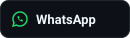

  
  
  
  

🇧🇷 Português &nbsp;·&nbsp; <a href="README.en.md">🇬🇧 English</a>

 

## Sobre

Sou engenheiro de software em Brasília, com mais de 4 anos de experiência. Trabalho no desenvolvimento de aplicações com Flutter e React Native, interfaces web modernas com Next.js e serviços desacoplados em Node.js com Prisma e bancos relacionais (MySQL e PostgreSQL).

Atualmente atuo no **Sistema Boss**, empresa de tecnologia responsável pelo ecossistema digital da Agência Sisters e Movimento Vida 360, onde gerencio releases mobile com Expo/EAS e migrei monólitos legados para APIs em Node.js. Também sou fundador e tech lead na **Exímia Tech**, onde arquiteto produtos SaaS e plataformas corporativas.

 

## 🛠️ Stack Tecnológica

  
  
  
  
  
  
  
  
  
  
  
  

 

## 📱 Aplicativos Publicados na App Store

<table>
  <tr>
    <td width="50%" valign="top">
      <h3>🚚 MyConnectedFleet by Michelin</h3>
      <b>Meta / Michelin · 2025</b>
      
App corporativo para rastreamento veicular e gestão de frotas globais em Flutter. Consumo de telemetria contínua via WebSocket e gRPC com gerenciamento de estado via BLoC. Escrevi testes unitários aumentando a cobertura da base de código de &lt;5% para mais de 95%.

      <a href="https://apps.apple.com/br/app/myconnectedfleet-by-michelin/id1573543686">Ver na App Store ↗</a> · <a href="https://connectedfleet.michelin.com/pt-br/solucoes/localizacao-e-rastreamento-veicular/">Solução Michelin ↗</a>
    </td>
    <td width="50%" valign="top">
      <h3>🎾 ArenaX</h3>
      <b>Exímia Tech / UCB · 2025</b>
      
Plataforma para gestão de torneios esportivos no formato Duplas Rotativas. Desenvolvido em parceria com a Universidade Católica de Brasília (UCB), conduzindo mentoria semanal para squad universitária.

      <a href="https://apps.apple.com/br/app/arenax/id6762231258">Ver na App Store ↗</a>
    </td>
  </tr>
  <tr>
    <td width="50%" valign="top">
      <h3>💼 Setteone CRM</h3>
      <b>Setteone · 2025</b>
      
Aplicação CRM B2B para operações e auditorias de campo. Arquitetura offline-first completa com SQLite e AsyncStorage, sincronização em nuvem via Firestore e processamento local de áudio com FFmpeg.

      <a href="https://apps.apple.com/us/app/setteone-crm/id6747451964">Ver na App Store ↗</a> · <a href="https://www.setteone.com.br/">setteone.com.br ↗</a>
    </td>
    <td width="50%" valign="top">
      <h3>🌱 Movimento Vida 360</h3>
      <b>Sistema Boss · 2026</b>
      
Plataforma corporativa de transmissões ao vivo e bem-estar para servidores públicos. App móvel em React Native com Expo, builds automatizados via EAS e atualizações OTA sem necessidade de nova revisão nas lojas.

      <a href="https://movimentovida360.com.br/">movimentovida360.com.br ↗</a>
    </td>
  </tr>
</table>

 

## 🌐 Plataformas Web & SaaS em Produção

<table>
  <tr>
    <td width="50%" valign="top">
      <h3>🏃 Sisters Esportes & Organizador</h3>
      <b>Sistema Boss · 2026</b>
      
Plataforma de criação e gestão de provas de corrida de rua, lotes de ingressos, categorias e checkout integrado com Pix e cartão, além do portal oficial de eventos esportivos da Agência Sisters.

      <a href="https://organizador.agenciasisters.com.br/">organizador.agenciasisters.com.br ↗</a> · <a href="https://esportes.agenciasisters.com.br/">Portal Esportes ↗</a>
    </td>
    <td width="50%" valign="top">
      <h3>📅 Agendai SaaS</h3>
      <b>Exímia Tech · 2025</b>
      
SaaS White-Label de agendamento online inteligente. Isolamento total de dados por empresa via Row Level Security (RLS) no PostgreSQL, dashboards em tempo real e bot com IA para WhatsApp.

      <a href="https://agendai.tec.br/">agendai.tec.br ↗</a>
    </td>
  </tr>
  <tr>
    <td width="50%" valign="top">
      <h3>🏢 ERP SGP Condomínios</h3>
      <b>Exímia Tech · 2025</b>
      
Sistema corporativo de gestão de condomínios com 24+ interfaces responsivas, controle de acesso por níveis (RBAC) e proteção de dados multi-tenant.

      Privado sob NDA
    </td>
    <td width="50%" valign="top">
      <h3>⚡ Exímia Tech</h3>
      <b>Site Institucional · 2025</b>
      
Plataforma institucional do estúdio e consultoria de produtos digitais, apresentando soluções corporativas e produtos entregues.

      <a href="https://eximiatech.com.br/">eximiatech.com.br ↗</a>
    </td>
  </tr>
</table>

 

## Trajetória

- **Sistema Boss (Agência Sisters) [Abr 2026 - Presente]:** Engenheiro de Software Pleno. Ciclo de release mobile (Expo/EAS), migração de monólitos legados para APIs em Node.js/Prisma, YouTube Live API e webhooks de pagamento.
- **Exímia Tech [Out 2023 - Presente]:** Fundador & Tech Lead. Arquitetura de produtos SaaS (Agendai, SGP ERP, ArenaX), liderança técnica e mentoria de squads.
- **Setteone [Nov 2025 - Abr 2026]:** Engenheiro de Software Mobile Pleno. CRM B2B offline-first (Flutter/React Native, SQLite, Firestore e FFmpeg).
- **Meta (Projeto Michelin) [Jul 2025 - Out 2025]:** Engenheiro de Software. App MyConnectedFleet em Flutter com gRPC e WebSocket. Elevação de cobertura de testes de &lt;5% para 95%+.
- **TRF 1ª Região [Abr 2022 - Abr 2024]:** Engenheiro de Software Fullstack. Monitoramento de servidores Linux com Python, Docker e pipelines CI/CD.

 

## Atividade no GitHub

  
  

 

  <picture>
    <source media="(prefers-color-scheme: dark)" srcset="https://raw.githubusercontent.com/GuiQueirozRibeiro/GuiQueirozRibeiro/output/github-contribution-grid-snake-dark.svg">
    <source media="(prefers-color-scheme: light)" srcset="https://raw.githubusercontent.com/GuiQueirozRibeiro/GuiQueirozRibeiro/output/github-contribution-grid-snake.svg">
    
  </picture>

